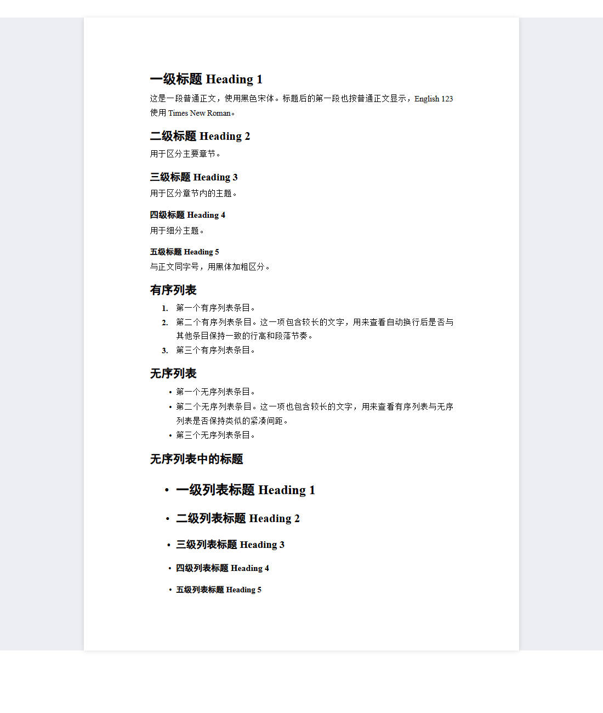

# Word-like Typora Theme

一个类似于word的，适合中文技术文档的浅色 Typora 主题。编辑界面呈现白纸与灰色桌面，PDF 使用 A4 页面；标题、正文、公式及列表采用统一的黑色排版。



## 安装

1. 下载本仓库中的 [`word-like.css`](word-like.css)。
2. 在 Typora 中打开「偏好设置 → 外观 → 打开主题文件夹」。
3. 将 CSS 文件复制到主题文件夹。
4. 重启 Typora，在「主题」菜单选择 **Word Like**。

Windows 默认主题目录为 `%APPDATA%\Typora\themes`。也可以下载本仓库后，在 PowerShell 中运行：

```powershell
.\install-theme.ps1
```

便携版或自定义目录可使用：

```powershell
.\install-theme.ps1 -ThemeDirectory 'D:\Typora\themes'
```

脚本会在替换同名主题前创建带时间戳的备份，不修改当前主题选择或导出配置。其他系统请使用 Typora 的「打开主题文件夹」手动安装。

## 字体与排版

| 内容 | 中文字体 | 英文及数字字体 | 字号 | 行距 |
| --- | --- | --- | --- | --- |
| H1 | 黑体 | Times New Roman | 18 pt | 1.4 倍 |
| H2 | 黑体 | Times New Roman | 16 pt | 1.4 倍 |
| H3 | 黑体 | Times New Roman | 14 pt | 1.4 倍 |
| H4 | 黑体 | Times New Roman | 12 pt | 1.4 倍 |
| H5 | 黑体 | Times New Roman | 11 pt | 1.4 倍 |
| H6（兼容样式） | 黑体 | Times New Roman | 11 pt | 1.4 倍 |
| 正文及列表 | 宋体 | Times New Roman | 11 pt | 1.75 倍，即 19.25 pt |

- 标题统一加粗、左对齐。
- 标题后的普通段落按正文显示，不自动添加居中、灰色或加粗格式。
- 有序、无序列表使用相同的行高，条目间不额外插入空白。
- 无序列表使用圆点 **•**，普通条目的圆点随条目字号缩放；`- ## 标题` 等标题列表的圆点与标题共用字号设置。
- 行内和独立公式的基础字号均为 **11 pt**，取消 Typora 默认的行内公式 95% 缩放；上下标、分式和积分符号保留数学排版比例。
- 表格、引用、代码块及任务列表有配套样式。

主题不下载在线字体。请在本机安装宋体、黑体和 Times New Roman；缺少字体时会回退到系统字体，换行与分页可能变化。数学字体的字形度量与正文字体不同，相同字号不表示所有符号具有相同的可见高度。

这里的 CSS 行距倍数按字号计算，Word 的行距还可能受字体度量、文档网格等设置影响，相同倍数不保证相同效果。

## PDF 导出

在「偏好设置 → 导出 → PDF」中设置以下参数，再使用「文件 → 导出 → PDF」：

| 选项 | 设置 |
| --- | --- |
| 主题 | Word Like，或使用已选中的当前主题 |
| 纸张 | A4，纵向，210 × 297 mm |
| 上、下页边距 | 各 25.4 mm（1 inch） |
| 左、右页边距 | 各 31.75 mm（1.25 inch） |
| 页眉、页脚 | 留空 |
| 一级标题之间分页 | 关闭 |

主题包含 `@page` 和打印样式。编辑界面的灰色背景、白纸外观、内边距与阴影不会应用到导出容器；导出布局在 `screen` 和 `print` 两种媒体下都移除这些装饰及额外透明边框，防止重复留白、缩放和位置偏移。

更新主题后请重启 Typora，并从源 Markdown 重新导出。已有 PDF 不会自动更新。LaTeX / Pandoc PDF 使用独立排版引擎，不会应用这个 CSS 主题。

## 示例与预览

- [`examples/最小二乘直线拟合理论推导.md`](examples/最小二乘直线拟合理论推导.md)：文字与公式较多的简易理论推导，包含正规方程、中心化解、矩阵形式、手算例子和正则化扩展。
- [`examples/least-squares-paper-en.md`](examples/least-squares-paper-en.md)：英文论文式示例，包含摘要、引言、最小二乘与正则化推导、数值验证、讨论和参考文献；使用明确给出的演示数据。
- PDF 下载：[中文理论推导](examples/最小二乘直线拟合理论推导.pdf)、[英文论文示例](examples/least-squares-paper-en.pdf)，均采用本主题的 A4 排版。
- [`examples/标题与列表.md`](examples/标题与列表.md)：标题层级、正文、有序及无序列表示例。
- [`example-preview.html`](example-preview.html)：理论推导示例的离线 HTML 预览。
- [`english-paper-preview.html`](english-paper-preview.html)：英文论文示例的离线 HTML 预览；也可查看[英文预览截图](assets/preview-en.png)。
- [`heading-preview.html`](heading-preview.html)：离线 HTML 预览，下载后用浏览器打开。

```markdown
# 一元线性最小二乘拟合的理论推导

设观测数据为 $(x_i,y_i)$，使用直线 $\hat{y}_i=ax_i+b$ 拟合。

## 残差平方和

最小化观测值与预测值之差的平方和：

$$
J(a,b)=\sum_{i=1}^{n}(y_i-ax_i-b)^2.
$$

## 参数求解

1. 分别对斜率和截距求偏导。
2. 令偏导数为零，得到正规方程。
3. 中心化数据，求得斜率与截距。
```

公式使用 Typora 的 `$...$` 和 `$$...$$` 语法；行内公式需在 Typora 的 Markdown 设置中启用。手动分页可在独立一行插入：

```html
<div class="page-break"></div>
```

## 自定义

编辑 `word-like.css` 顶部的 CSS 变量：

| 变量 | 用途 |
| --- | --- |
| `--word-body-font` | 正文字体 |
| `--word-heading-font` | 标题字体 |
| `--word-h1-size` 至 `--word-h6-size` | 各级标题及其列表圆点的字号 |
| `--word-leading` | 正文及列表行距，默认 `1.75` |

屏幕纸张外观位于 `@media screen` 中，打印页面设置位于 `@page` 中。修改页边距时，也请同步检查 Typora 的 PDF 导出设置。编辑显示允许字号缩放，导出固定使用 11 pt 正文基准。

## 兼容性与验证

在 Windows、Typora 1.14.9 环境中制作，使用 Chromium 和 Typora 基础样式检查了标题、字体、公式、列表、窄窗口和 PDF 页面布局；PDF 导出偏移修正已在实际使用中确认有效。其他平台的字体回退和 Typora 版本差异仍可能影响排版。

如出现与预览不一致的样式，请检查主题目录中的 `base.user.css` 和 `word-like.user.css`；它们会在主题后加载并覆盖规则。离线 HTML 预览内嵌 CSS，修改主题后需同步更新 HTML 中的主题样式。

相关官方说明：[安装主题](https://support.typora.io/About-Themes/)、[自定义 CSS](https://support.typora.io/Add-Custom-CSS/)、[PDF 导出](https://support.typora.io/Export/#pdf)。
